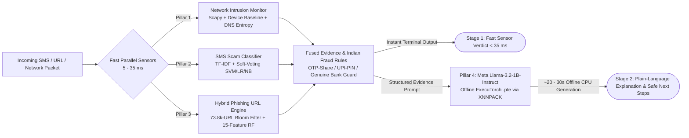

# AEGIS EDGE — On-Device AI Cybersecurity Assistant
**ARM Bharat AI-SoC Challenge 2026–27 | Problem Statement 3**

> **Full Setup, Hugging Face Model Access & Testing Instructions:** See [**`SETUP.md`**](./SETUP.md)

---

## 1. Overview
**AEGIS EDGE** is a 100% offline, on-device AI cybersecurity assistant built for resource-constrained Arm and Linux edge devices (such as Raspberry Pi 5 and edge laptops) with **zero cloud dependency**.

It combines **three millisecond-speed threat sensors** (Network Intrusion Detection, SMS Scam Ensemble ML, and a Hybrid Phishing URL Detector) with a **local quantized Meta Llama-3.2-1B-Instruct model running on ExecuTorch (XNNPACK)**. Instead of relying on an LLM to guess whether raw traffic is malicious, our fast deterministic/ML sensors extract machine-verifiable evidence in **5–35 milliseconds**, and Llama translates that evidence into plain-English explanations and concrete safety actions for non-technical users.

---

## 2. The 4-Pillar Architecture



### Pillar Breakdown
1. **Pillar 1 — Network Intrusion Detection (`traffic_monitor/`):**
   * Captures live packets using `scapy`, learns a per-device golden baseline, and detects **Port Scans** (fast and slow), **SYN Floods**, **ICMP Ping Floods**, **Brute-Force Connection Attempts**, and **High-Entropy DNS Exfiltration / DGA Malware**.
2. **Pillar 2 — SMS Scam Ensemble Classifier (`sms_detector/`):**
   * Two-stage text normalization + word/character n-gram TF-IDF pipeline feeding a soft-voting ensemble of **Calibrated LinearSVC (weight 2)**, **Logistic Regression (weight 2)**, and **Multinomial Naive Bayes (weight 1)**.
   * Paired with an **Indian Banking / UPI / OTP Evidence Layer** in `llama_advisor.py` that catches OTP-sharing traps and UPI PIN collect traps while preventing false alarms on genuine bank OTP/transaction notifications (`15/15 = 100%` accuracy on `sms_test.txt`).
3. **Pillar 3 — Hybrid Phishing URL Detector (`phishing_detector/`):**
   * **Stage A (Zero-Latency Blacklist):** Compresses **73,819 verified phishing URLs** (PhishTank + CompPhish) into a **225 KB Bloom Filter (`bloom_filter.bin`)** for $O(1)$ instant lookups.
   * **Stage B (Zero-Day ML Catcher):** A 15-feature **Random Forest Classifier (`phishing_rf_model.joblib`)** trained on 20,028 balanced URLs using **CompPhish's Markov-chain character transition gibberish model (`gib_model.pki`)**, brand-impersonation detection, URL shortener lists (`shortUrls.txt`), and abused free-hosting lists (`free_hosting_services.txt`).
4. **Pillar 4 — Offline Llama-3.2-1B ExecuTorch Advisor (`llama_advisor.py` + `llama32_1b_instruct/`):**
   * Runs `meta-llama/Llama-3.2-1B-Instruct` quantized to 4-bit weights (`8da4w`) inside Meta's **ExecuTorch (`model.pte`)** runtime using the **XNNPACK** CPU backend, with the tokenizer saved locally for 100% air-gapped operation.

---

## 3. Repository Structure

```text
codebase/
├── README.md                       # Project overview & architecture (this file)
├── SETUP.md                        # Complete setup, Hugging Face export & test guide
├── .gitignore                      # Excludes 1.7 GB model.pte, venv/, and logs from Git
├── requirements.txt                # CPU-optimized Python dependencies
├── llama_advisor.py                # MAIN 4-PILLAR COORDINATOR (SMS + URL + Network + Llama)
├── test_llama.py                   # Standalone Llama-3.2-1B ExecuTorch chat script
├── llama32_1b_instruct/            # Offline tokenizer files + model.pte (generated locally)
├── phishing_detector/              # Bloom Filter + CompPhish/PhishTank Random Forest engine
├── sms_detector/                   # Soft-voting SMS Scam classifier + Indian SMS test suite
└── traffic_monitor/                # Scapy network intrusion monitor + DNS attack simulator
```

---

## 4. Quick Start (`venv` is Optional!)

For full OS-specific prerequisites and test cases, read [**`SETUP.md`**](./SETUP.md).

### Step 1: Install Python Dependencies
* **Without `venv` (Direct / Global Python — if you never used `venv`):**
  ```bash
  cd codebase
  pip install -r requirements.txt
  ```
* **With `venv` (Optional — if you prefer an isolated environment):**
  ```bash
  python3 -m venv venv
  source venv/bin/activate      # Windows PowerShell: .\venv\Scripts\Activate.ps1
  cd codebase
  pip install -r requirements.txt
  ```

### Step 2: Obtain or Export `model.pte` (Hugging Face Approval Required Once)
Because `llama32_1b_instruct/model.pte` is **1.7 GB**, it is ignored by `.gitignore`. Either copy `model.pte` from a teammate into `codebase/llama32_1b_instruct/model.pte`, **or** export it once using Hugging Face:
1. Accept Meta's community license on [**meta-llama/Llama-3.2-1B-Instruct**](https://huggingface.co/meta-llama/Llama-3.2-1B-Instruct).
2. Generate a **Read** access token at [**huggingface.co/settings/tokens**](https://huggingface.co/settings/tokens) and log in:
   ```bash
   huggingface-cli login
   ```
3. Export the quantized ExecuTorch model into `./llama32_1b_instruct`:
   ```bash
   optimum-cli export executorch \
     --model "meta-llama/Llama-3.2-1B-Instruct" \
     --task "text-generation" \
     --recipe "xnnpack" \
     --qlinear 8da4w \
     --output_dir "./llama32_1b_instruct"
   ```

### Step 3: Run the Unified 4-Pillar Advisor
```bash
python llama_advisor.py
```
*(Or run `python llama_advisor.py --demo` to execute the automated 4-case benchmark demo.)*

> ### ⏱️ Note on Offline Llama Response Time (~25–30 Seconds)
> When you enter an SMS, URL, or Network alert in `llama_advisor.py`:
> * **Stage 1 (`[FAST SENSOR BREAKDOWN]`):** Prints **instantly (~5–35 ms)** with the parallel SMS ML + Phishing URL ML verdict, confidence, and extracted technical evidence.
> * **Stage 2 (`>>> AEGIS Llama Advisory`):** Takes **~20 to 30 seconds** because `Llama-3.2-1B-Instruct` (`model.pte`) is generating the plain-English advisory **100% offline on your local CPU via ExecuTorch** (~4.3 tokens/sec, zero cloud calls).

---

## 5. Next Steps for the Team
See [**`SETUP.md`**](./SETUP.md) for the copy-paste test suite and next modules to pick up:
1. **Live Network Alert Watcher:** Tail `traffic_monitor/alerts.jsonl` into `llama_advisor.py`.
2. **Local Web Dashboard UI:** Display the instant (<35 ms) sensor breakdown card immediately while streaming the ~25–30s Llama ExecuTorch explanation.
3. **Arm SoC Benchmarking:** Record `PyTorchObserver` latency, tokens/sec, and RAM metrics on Raspberry Pi 5 for the PS3 Technical Report.
